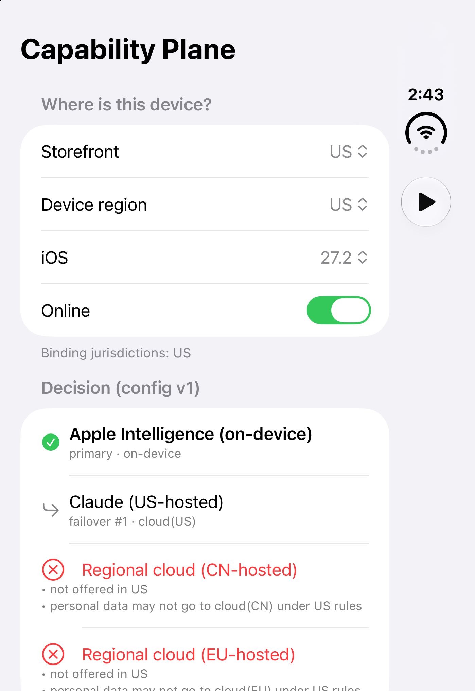
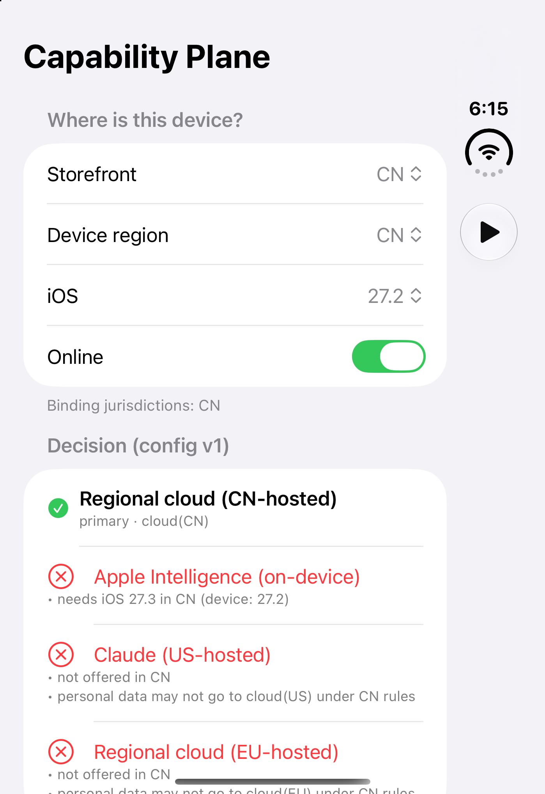
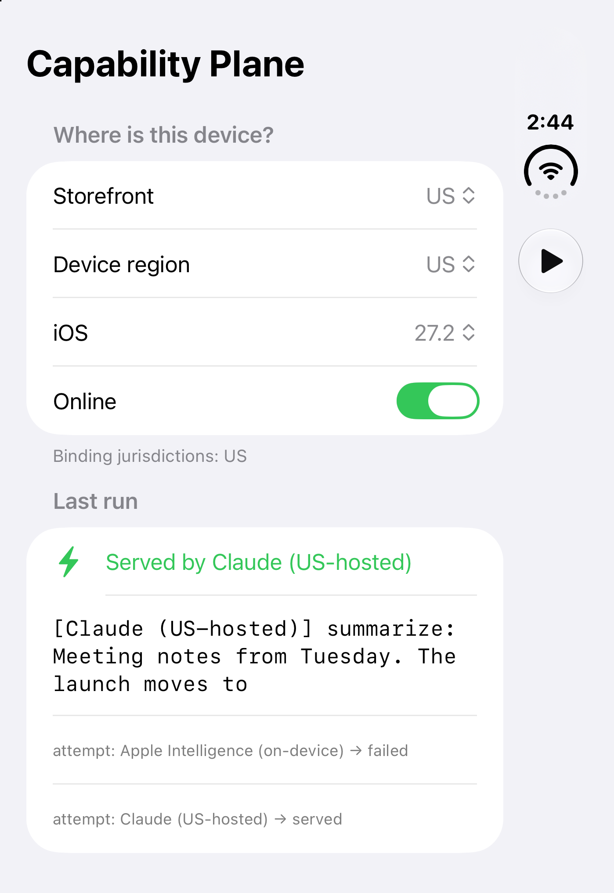
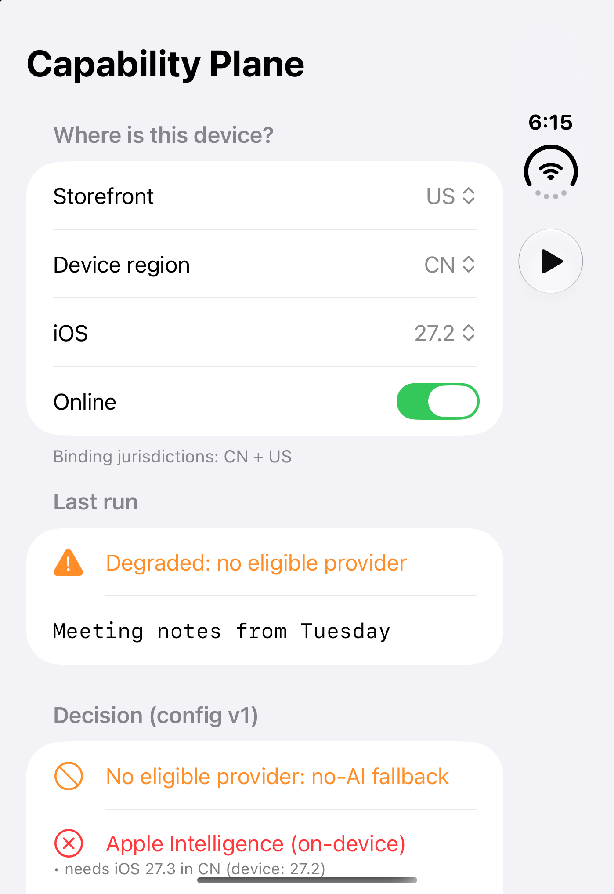

# Capability Plane — Demo App

**Same Summarize button, different rules in every market, and a stated reason behind every answer.** This iOS app is a console for [`ai-capability-plane-kit`](https://github.com/rajatslakhina/ai-capability-plane-kit). Pick a storefront, a device region, an iOS version and a data class, and watch the plane decide *who* is allowed to answer a "Summarize" request. Then run the request for real through simulated providers.

| **US, iOS 27.2 (default).** Decision: on-device primary, US-hosted cloud as failover. EU- and CN-hosted clouds are rejected, with reasons. | **China, iOS 27.2.** Decision: on-device is rejected because it "needs iOS 27.3 in CN". The CN-hosted cloud is primary, and Claude is rejected on residency. |
|---|---|
|  |  |
| **US, on-device outage, run.** Attempt 1 (on-device) fails. The request fails over to the US-hosted cloud and never to the EU or CN cloud. | **US account, device in China, run.** Both rule sets bind, nothing qualifies, and the request falls back to the no-AI result. |
|  |  |

*These are real screenshots, not mockups. They were captured with `xcrun simctl io … screenshot` from **this project as committed**, with `ai-capability-plane-kit` resolved from GitHub at **v1.1.0**, running on an iPhone Duo Simulator (iOS 27.2, Xcode 27.2) and driven by launch arguments. See [Verification](#verification).*

## Why this matters

iOS 27.3 brings Apple Intelligence to China with a different stack and a different feature set. From then on, "which model answers this request?" depends on storefront, device region, OS version and data sensitivity. An app that decides this with scattered `Locale` checks has residency decisions nobody reviews and nothing that can be switched off remotely. The library turns those decisions into a single policy that can be tested and explained. This app makes that policy visible.

## What you can do in the console

- **Where is this device?** Storefront and device region (US, CN, DE, IN), iOS 27.2 or 27.3, online or offline. The footer shows which jurisdictions' rules currently bind. When the storefront and region differ, it shows two.
- **Decision.** The ranked chain (primary, then failovers) and every rejected provider with *all* of its reasons. Examples: `needs iOS 27.3 in CN (device: 27.2)`, `personal data may not go to cloud(US) under CN rules`, `kill[US/apple.ondevice/*]`.
- **Run request** (▶ in the toolbar, or the button in the request section). This is a real `CapabilityPlane.perform` call through simulated adapters with 350 ms of latency. "Last run" shows who served the request, or why it fell back to the no-AI result, and the full list of attempts.
- **Operations.** *Kill* sends a strictly newer config, applied atomically inside the plane, with a kill switch scoped to the jurisdictions that currently bind. "Killed" always reflects the *current* region, so a US-scoped kill does not show as killed after you switch to DE. *Up/Down* simulates a provider outage. Two failures open its circuit breaker.
- **Eval parity.** The best score per market for each capability. Gaps over 10 points are highlighted.

## Design notes (app side)

- **The app owns the policy.** `Demo/DemoFleet.swift` defines the fleet, the residency rules, the jurisdiction map and the eval scores. The library's `CapabilityConsoleView` only renders whatever plane it is handed. In production the same config would arrive remotely with a version number, and this copy would ship in the binary as the last-known-good fallback.
- **The package is pinned to a version, not tracked by branch.** `Demo.xcodeproj` references the library as an `XCRemoteSwiftPackageReference` at `https://github.com/rajatslakhina/ai-capability-plane-kit`, `upToNextMajorVersion` from `1.1.0`, and the committed `Package.resolved` pins the exact v1.1.0 revision. Every clone and every CI run resolves a released tag, never whatever `main` happens to be that day. The floor is 1.1.0 rather than 1.0.0 on purpose: v1.1.0 is the release whose auditor checks registered descriptors, and the demo should never be able to resolve the version without that fix.
- **Launch arguments for scripted runs.** `-storefront CN -region CN -os 27.3 -outage apple.ondevice -autorun YES`. Anything missing or invalid falls back to a default: storefront US, device region equal to the storefront, iOS 27.2, no outage and no autorun. This is how the four screenshots above were produced without touching the UI.

### Trade-offs and rejected alternatives

- **The app owns the policy rather than the library bundling a default.** This costs some boilerplate in `DemoFleet.swift`. The rejected alternative was a "reference fleet" inside the library. It would make the demo shorter, but it invites production apps to ship someone else's residency rules unread.
- **`upToNextMajorVersion` plus a committed `Package.resolved`, rather than `exactVersion`.** The range lets a consumer pick up 1.x fixes deliberately with *Update Package*. The committed resolved file means a fresh clone builds the exact revision CI built until someone bumps it. The rejected options: tracking a branch makes builds irreproducible, and an exact pin means every patch release needs a pbxproj edit. The one deliberate exception is a safety fix: then the floor moves up, as it did to 1.1.0, so the affected version can no longer be resolved at all.
- **Launch arguments rather than a UI-test target for screenshots.** Arguments are about ten lines of code and work with `simctl` in any script. A UI-test target would also be able to tap through the flow. It is the better long-term choice and the obvious next step, but it would double the project surface for one screenshot set. The logic behind the console is unit-tested in the library (`ConsoleModelTests`).
- **Simulated adapters, not live providers.** The demo shows the *policy*, not model quality, and it has to run offline without keys. Adapters for Foundation Models, a regional SDK or an HTTP model API plug into the same `ProviderAdapter` protocol.

## How to run it

1. `git clone https://github.com/rajatslakhina/ai-capability-plane-demo-app.git`
2. Open `Demo.xcodeproj` in Xcode 16 or later. Xcode resolves `ai-capability-plane-kit` from GitHub.
3. Select the **Demo** scheme and any iOS 17+ Simulator.
4. Build & Run (⌘R). Set **both** storefront and device region to **CN** and watch the decision change. Changing only the storefront makes CN and US rules both apply, and the expected result is the no-AI fallback. Tap ▶ to run the request.

To reproduce a screenshot from the command line, launch with arguments, for example `xcrun simctl launch booted com.rajatlakhina.CapabilityPlaneDemo -storefront US -region CN -os 27.2 -autorun YES`.

## Verification

- **It runs on a Simulator, built from this repo as committed.**
  - On 2026-11-02 this project (v1.0.1), unmodified, resolved `ai-capability-plane-kit` from GitHub at **v1.1.0** (revision `d3fbf35`, pinned in the committed `Package.resolved`) and built with Xcode 27.2.
  - It was installed on an iPhone Duo Simulator (iOS 27.2) and launched in all four launch-argument scenarios. The app was confirmed still running after each screenshot, and the four screenshots above are from those runs.
  - Scenarios 03 and 04 dispatched a real `CapabilityPlane.perform`: 03 served by the US-hosted cloud after the simulated on-device failure, and 04 fell back to the no-AI result.
- **CI** ([Actions tab](https://github.com/rajatslakhina/ai-capability-plane-demo-app/actions/workflows/ci.yml)). On `macos-15` (the job prints Xcode 16.4), `xcodebuild -resolvePackageDependencies` fetched the package from GitHub at `1.1.0`. The `Demo` scheme then built for `generic/platform=iOS Simulator` (`BUILD SUCCEEDED`). That job is compile-only, so the Simulator runs above are the evidence that the app actually launches.
- **History.** v1.0.0's screenshots came from runs against a local checkout of the library, made before it was published. After publishing, the v1.0.0 project was built against GitHub `v1.0.0`, and the outage scenario was re-run. In v1.0.1, all four screenshots come from the unmodified project resolving v1.1.0 from GitHub.

## License

MIT
